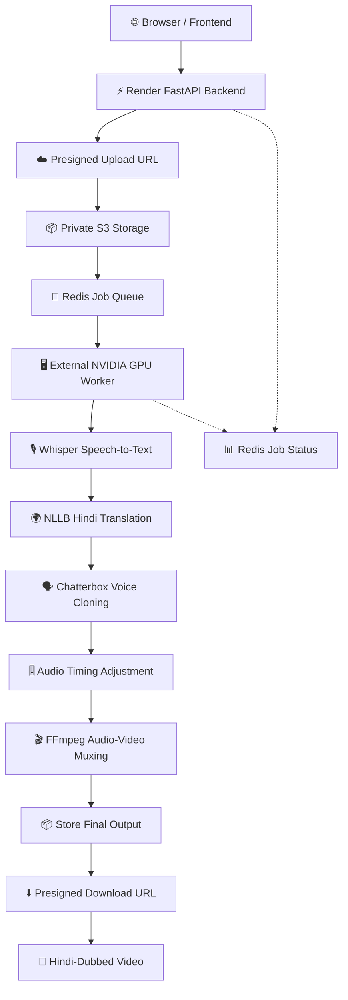
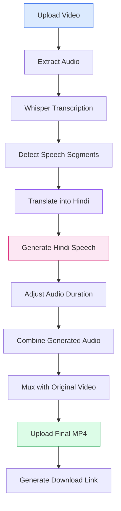
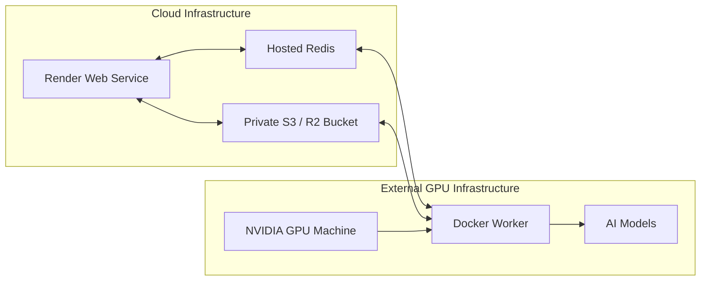
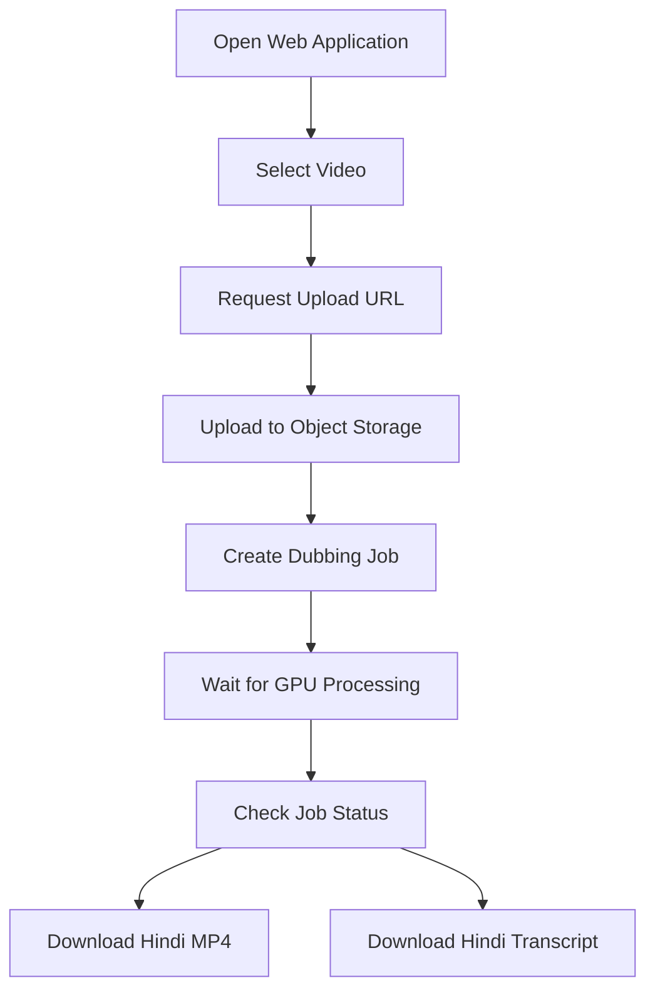

# 🎙️ HindiDub AI — AI-Powered Video Dubbing Platform

### Open-source AI video dubbing with Hindi translation, voice cloning, and synchronized audio — powered by an external NVIDIA GPU worker.

<p align="center">
  
  
  
  
  
  
  
</p>

---

## 📌 Overview

**HindiDub AI** is an AI-powered video dubbing platform designed to convert videos from supported languages into Hindi while attempting to preserve the original speaker's vocal characteristics and the video's original visual frames.

The project uses a **split-deployment architecture**:

- **Render** hosts the lightweight FastAPI backend and web application.
- **External NVIDIA GPU machines** execute computationally intensive AI workloads.
- **Redis** manages job queues and processing status.
- **Private S3-compatible object storage** stores uploaded videos, generated audio, transcripts, and final outputs.

Large video files are uploaded directly from the browser to object storage using presigned URLs. This avoids routing multi-gigabyte uploads through Render's application server or depending on its ephemeral local disk.

## 🎯 Project Objectives

- Build an AI-powered video dubbing platform.
- Convert supported source-language speech into Hindi.
- Generate Hindi speech using multilingual voice cloning.
- Preserve the original compressed video stream wherever compatible.
- Synchronize generated speech with detected speech segments.
- Process large videos using external GPU infrastructure.
- Separate lightweight web hosting from heavy AI computation.
- Provide downloadable dubbed videos and Hindi transcripts.

## ✨ Key Features

| Feature | Description |
|---|---|
| 🎬 Video Upload | Upload videos through a browser interface |
| ☁️ Direct Storage Upload | Upload files directly to private object storage |
| 🎙️ Speech Recognition | Extract speech using OpenAI Whisper |
| 🌍 Hindi Translation | Translate recognized speech using Meta NLLB |
| 🗣️ Voice Cloning | Generate Hindi speech using Chatterbox |
| 🎚️ Audio Timing | Adjust generated speech to fit detected segment durations |
| 🎥 Frame Preservation | Copy the original video stream during final muxing |
| ⚡ GPU Processing | Run AI inference on an external NVIDIA GPU machine |
| 📊 Job Tracking | Track processing status through Redis |
| 📥 Video Download | Generate temporary download links |
| 📝 Transcript Download | Access the generated Hindi transcript |

## 🏗️ System Architecture

HindiDub AI uses a distributed architecture in which the web application, job queue, object storage, and GPU worker operate independently.



### Architecture Components

| Component | Responsibility |
|---|---|
| Browser | Video selection, upload, job creation, and downloads |
| Render API | Authentication-free demo API, request handling, and URL signing |
| Redis | Job queue and processing status |
| Object Storage | Private upload, intermediate, and output file storage |
| GPU Worker | Executes the AI processing pipeline |
| Whisper | Speech recognition and timestamps |
| NLLB | Hindi translation |
| Chatterbox | Multilingual speech generation and voice cloning |
| FFmpeg | Audio timing and final video muxing |

## 🔄 AI Processing Workflow



### Processing Pipeline

1. **Video Upload:** The browser requests a presigned upload URL and uploads the selected video directly to private object storage.
2. **Job Creation:** The API creates a processing job and places it in the Redis queue.
3. **Speech Recognition:** The GPU worker downloads the video and uses Whisper to identify speech and generate timestamps.
4. **Translation:** Recognized text is translated into Hindi using NLLB.
5. **Voice Generation:** Chatterbox generates Hindi speech using an extracted voice reference.
6. **Timing Adjustment:** FFmpeg adjusts generated audio duration to fit the detected speech segments.
7. **Video Muxing:** The generated audio is combined with the original video stream.
8. **Output Storage:** The final MP4 and transcript are uploaded to object storage.
9. **Download:** The application provides short-lived presigned download URLs.

## 🧰 Technology Stack

| Category | Technology |
|---|---|
| Backend | Python, FastAPI |
| Deployment | Render |
| Job Queue | Redis / Upstash Redis |
| Object Storage | Cloudflare R2 / AWS S3 |
| Speech Recognition | OpenAI Whisper |
| Translation | Meta NLLB-200 |
| Voice Cloning | Chatterbox Multilingual |
| Deep Learning | PyTorch, CUDA |
| Audio Processing | FFmpeg |
| Video Inspection | FFprobe |
| Infrastructure | Docker, NVIDIA GPU |
| Model Distribution | Hugging Face |

## ☁️ Deployment Architecture

The project separates web hosting from AI inference to make GPU-intensive video processing possible without running large models on Render.



### Required Services

| Service | Purpose | Example |
|---|---|---|
| Render Web Service | Host frontend and FastAPI | Render |
| Redis | Job queue and status | Upstash Redis |
| Object Storage | Store videos and results | Cloudflare R2 / AWS S3 |
| GPU Machine | Run AI inference | RunPod, Vast.ai, or own NVIDIA machine |
| Model Repository | Download AI model weights | Hugging Face |

**Important:** Do not run the GPU worker on Render Free. Use a separate NVIDIA CUDA-capable machine.

---

## 🚀 Installation & Deployment

### 1. Clone the Repository

```bash
git clone https://github.com/YOUR_USERNAME/HindiDub-AI.git
cd HindiDub-AI
```

Replace the repository URL with your actual GitHub repository.

### 2. Configure Redis

Create a Redis-compatible service, such as Upstash Redis.

Obtain the Redis connection URL and configure:

```env
REDIS_URL=rediss://your-redis-connection-url
```

The API and GPU worker must use the same Redis connection and database.

### 3. Configure Private Object Storage

Create a private bucket in Cloudflare R2 or AWS S3.

Generate access credentials with permissions limited to the required bucket.

Configure the following environment variables:

```env
S3_BUCKET=your-private-bucket
S3_ENDPOINT_URL=https://your-s3-endpoint
S3_ACCESS_KEY_ID=your-access-key
S3_SECRET_ACCESS_KEY=your-secret-key
S3_REGION=auto
S3_ADDRESSING_STYLE=path
```

For Cloudflare R2, the endpoint generally follows this pattern:

```text
https://<account-id>.r2.cloudflarestorage.com
```

Never expose storage credentials in frontend JavaScript or commit them to Git.

### 4. Configure Storage CORS

Allow your exact Render domain to upload and download objects.

Example CORS configuration:

```json
[
  {
    "AllowedOrigins": [
      "https://YOUR-SERVICE.onrender.com"
    ],
    "AllowedMethods": [
      "PUT",
      "GET",
      "HEAD"
    ],
    "AllowedHeaders": [
      "Content-Type",
      "*"
    ],
    "ExposeHeaders": [
      "ETag"
    ],
    "MaxAgeSeconds": 3600
  }
]
```

Provider-specific configuration syntax may differ. Apply the settings using your storage provider's dashboard or API.

### 5. Deploy the Web API on Render

1. Push the project to GitHub.
2. Open the Render dashboard.
3. Select **New → Blueprint**, then connect your repository, or create a Python Web Service manually.
4. Configure the following commands.

**Build Command**

```bash
pip install -r requirements-web.txt
```

**Start Command**

```bash
uvicorn app.main:app --host 0.0.0.0 --port $PORT
```

**Health Check Path**

```text
/api/health
```

Add the Redis and S3 environment variables in the Render dashboard.

The Render service only handles the UI, API, job management, and presigned URL generation. It does not load PyTorch or the AI models.

### 6. Build the External GPU Worker

The worker requires an NVIDIA GPU, compatible drivers, and NVIDIA Container Toolkit.

On an Ubuntu GPU machine, clone the repository and build the worker image:

```bash
docker build -f Dockerfile.worker -t hindidub-worker .
```

Run the worker:

```bash
docker run --gpus all --restart unless-stopped \
  -e REDIS_URL='rediss://your-redis-url' \
  -e S3_BUCKET='your-private-bucket' \
  -e S3_ENDPOINT_URL='https://your-s3-endpoint' \
  -e S3_ACCESS_KEY_ID='your-access-key' \
  -e S3_SECRET_ACCESS_KEY='your-secret-key' \
  -e S3_REGION='auto' \
  -e S3_ADDRESSING_STYLE='path' \
  -e WHISPER_MODEL='small' \
  hindidub-worker
```

For better secret handling, use a protected environment file:

```bash
docker run --gpus all --restart unless-stopped \
  --env-file /secure/path/hindidub.env \
  hindidub-worker
```

Do not add `--rm` when you want the worker container to remain available for restart policies.

The Docker image uses a CUDA-enabled PyTorch base image. Verify compatibility between the image, CUDA runtime, and host NVIDIA driver.

### 7. Run Without Docker (Ubuntu)

Install:

- Python 3.10 or 3.11
- FFmpeg and FFprobe
- Compatible CUDA-enabled PyTorch and torchaudio
- Required system dependencies

Install worker dependencies:

```bash
pip install -r requirements-worker.txt
```

Configure the Redis and S3 environment variables, then run:

```bash
python -m worker.worker
```

Use systemd or another process supervisor to keep the worker running.

Start with one worker per GPU until memory requirements and concurrency have been tested.

---

## ⚙️ Environment Variables

| Variable | Description | Default / Example |
|---|---|---|
| `REDIS_URL` | Shared Redis connection | `rediss://...` |
| `S3_BUCKET` | Private storage bucket | Required |
| `S3_ENDPOINT_URL` | S3-compatible endpoint | Provider endpoint |
| `S3_ACCESS_KEY_ID` | Storage access key | Required |
| `S3_SECRET_ACCESS_KEY` | Storage secret | Required |
| `S3_REGION` | Storage region | `auto` |
| `S3_ADDRESSING_STYLE` | S3 addressing configuration | `path` |
| `MAX_UPLOAD_BYTES` | Maximum upload size | 2 GiB |
| `MAX_DURATION_SECONDS` | Maximum video duration | 1800 seconds |
| `WHISPER_MODEL` | Speech recognition model | `small` |
| `TRANSLATION_MODEL` | Translation model | `facebook/nllb-200-distilled-600M` |
| `WORK_DIR` | Worker temporary directory | `/workspace/jobs` |

### Whisper Model Options

| Model | Relative Resource Usage | Notes |
|---|---|---|
| `base` | Lower | Uses less memory |
| `small` | Moderate | Default configuration |
| `medium` | Higher | May improve recognition at greater computational cost |

Model selection should be tested against your GPU's available VRAM and the quality of your source audio.

---

## 👨‍💻 User Workflow



1. Open the deployed Render application.
2. Select a video from your device.
3. Upload the video directly to private object storage.
4. Submit the dubbing job.
5. The GPU worker processes the video and updates job progress.
6. Download the generated MP4 or Hindi transcript from the result card.

**Current documented upload limits:**

- Maximum file size: 2 GiB by default.
- Maximum video duration: 30 minutes by default.
- Upload URL validity: One hour.
- Download URL validity: One hour.

Actual processing time depends on video duration, model selection, hardware, and available resources.

## 🔌 API Documentation

Base URL:

```text
https://YOUR-SERVICE.onrender.com
```

| Method | Endpoint | Description |
|---|---|---|
| `GET` | `/api/health` | Check API health |
| `POST` | `/api/uploads/presign` | Generate presigned upload URL |
| `POST` | `/api/jobs` | Create a dubbing job |
| `GET` | `/api/jobs/{job_id}` | Retrieve job status |
| `GET` | `/api/jobs/{job_id}/download` | Generate video download URL |
| `GET` | `/api/jobs/{job_id}/transcript` | Generate transcript download URL |

### Generate an Upload URL

**Endpoint**

```http
POST /api/uploads/presign
Content-Type: application/json
```

**Request**

```json
{
  "filename": "clip.mp4",
  "size": 1234,
  "content_type": "video/mp4"
}
```

The API returns a presigned upload URL and the headers required for the browser's storage upload.

### Upload the Video

The browser performs a `PUT` request to the returned `upload_url`, using the returned headers.

### Create a Job

**Endpoint**

```http
POST /api/jobs
Content-Type: application/json
```

**Request**

```json
{
  "job_id": "...",
  "filename": "clip.mp4",
  "object_key": "uploads/..."
}
```

### Check Job Status

```http
GET /api/jobs/{job_id}
```

### Download the Dubbed Video

```http
GET /api/jobs/{job_id}/download
```

Returns a short-lived download URL as JSON.

### Download the Transcript

```http
GET /api/jobs/{job_id}/transcript
```

Returns a short-lived transcript URL as JSON.

For interactive API exploration, open:

```text
https://YOUR-SERVICE.onrender.com/docs
```

---

## ⚠️ Important Limitations & Caveats

HindiDub AI is an experimental AI dubbing pipeline. Its output should be reviewed before professional or public distribution.

| Area | Current Limitation |
|---|---|
| Voice Cloning | Generated speech approximates the reference voice; it may differ in pitch, accent, emotion, and pronunciation |
| Timing | Speech is fitted to detected segment slots; this is not precise lip synchronization |
| Original Audio | The entire original audio track is replaced, including background music and sound effects |
| Video Preservation | FFmpeg copies the original compressed video stream using `-c:v copy`; unusual formats may require remuxing |
| Language Coverage | Only languages mapped in `NLLB_CODES` are supported |
| GPU Resources | Long videos require substantial GPU VRAM, CPU RAM, and temporary disk |
| Voice Reference | A 12-second reference is extracted from the beginning of the audio and may be unsuitable if it contains no clean speech |
| Job Reliability | The basic worker processes a queued job once; production retry and dead-letter handling are not included |
| Storage | Redis status expires after seven days; object storage requires separate lifecycle cleanup |
| Security | The sample API has no user accounts and is intended as a controlled demo |

### Performance Considerations

A 30-minute video can take a substantial amount of time to process.

Recommended initial testing:

- Begin with a 1–2 minute video.
- Test the `base` or `small` Whisper model.
- Run only one job per GPU initially.
- Monitor GPU VRAM, CPU RAM, and temporary disk usage.
- Test multiple source languages and audio conditions.

### Model Licensing

The default NLLB-200 distilled 600M model is licensed under **CC-BY-NC 4.0**.

The default stack is therefore not automatically cleared for commercial use. Review the licenses and usage restrictions of every model, dependency, and service before commercial deployment.

### Responsible Voice Cloning

Only use voice references that you own or have explicit permission to use. Do not use this project to impersonate people or create deceptive audio.

---

## 🔐 Security & Production Readiness

The current implementation should be treated as a controlled demo rather than a production-ready multi-tenant service.

Before public launch, consider implementing:

- User authentication and authorization.
- Per-user job and object-key isolation.
- Upload quotas and rate limiting.
- CSRF and CORS hardening.
- File-type validation and abuse prevention.
- Secure secret management.
- Object storage lifecycle and deletion policies.
- Monitoring, structured logs, and alerting.
- Job retries, dead-letter queues, and stale-job recovery.
- Worker concurrency controls.
- Download access authorization.

Keep storage buckets private and never expose access credentials to the browser.

---

## 🛠️ Troubleshooting

| Problem | Possible Solution |
|---|---|
| CORS or PUT upload fails | Configure storage CORS for the exact Render origin and required headers |
| GPU worker stays idle | Verify Redis connectivity and ensure API and worker use the same Redis database |
| S3 signature mismatch | Verify endpoint, region, addressing style, and system clock |
| CUDA out-of-memory | Try `WHISPER_MODEL=base`, reduce concurrency, or use a GPU with more VRAM |
| FFmpeg not found | Verify `ffmpeg -version` and `ffprobe -version` inside the worker container |
| First job is slow | Allow time for initial model-weight downloads |
| Unsupported source language | Check whether the detected language is mapped in `NLLB_CODES` |
| Chatterbox model error | Check upstream Chatterbox documentation and verify that the installed package matches the code |
| Download link expires | Request a fresh download URL through the API |

---

## 📁 Project Structure

The exact repository layout should match the files committed to your GitHub repository. The main deployment components are:

```text
HindiDub-AI/
│
├── app/
│   └── main.py
│
├── worker/
│   └── worker.py
│
├── requirements-web.txt
├── requirements-worker.txt
├── Dockerfile.worker
├── render.yaml
│
└── README.md
```

Additional frontend, processing, configuration, and utility modules may exist in the full repository.

## 🚧 Future Enhancements

Potential improvements for future versions:

- [ ] User registration and authentication.
- [ ] Multiple target-language support.
- [ ] Improved speaker diarization.
- [ ] Multiple-speaker voice reference management.
- [ ] Better background music and sound-effect preservation.
- [ ] More accurate speech alignment and lip synchronization.
- [ ] Retry and dead-letter job handling.
- [ ] Job cancellation and recovery.
- [ ] Real-time processing progress.
- [ ] GPU worker autoscaling.
- [ ] Configurable video and audio quality.
- [ ] Persistent user job history.
- [ ] Production-grade monitoring and observability.

## 🎓 Learning Outcomes

This project demonstrates practical experience with:

- Distributed application architecture.
- FastAPI backend development.
- Asynchronous job processing with Redis.
- Presigned object storage uploads and downloads.
- GPU-based machine learning inference.
- Speech recognition and machine translation.
- Multilingual voice cloning.
- FFmpeg audio/video processing.
- Docker-based deployment.
- Cloud deployment and infrastructure separation.
- Handling large media files without relying on ephemeral web-server storage.

## 👨‍💻 Developer

<div align="center">

### Lakshya Kansal

**Developer of HindiDub AI**

Building practical AI applications by combining backend engineering, open-source models, and cloud infrastructure.

</div>

---

## ⭐ Support

If you find this project interesting, consider giving the repository a ⭐ on GitHub.

Contributions, suggestions, and feedback are welcome.

<p align="center">
  <b>HindiDub AI — Breaking Language Barriers Through AI-Powered Dubbing.</b>
</p>
